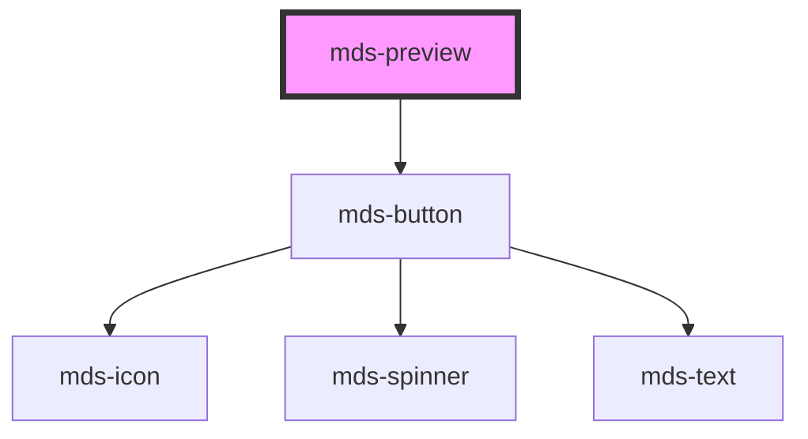

# mds-preview

<!-- Auto Generated Below -->

## Overview

The result of an editor, drawn at a width of its own and fitted to its box, so the person
judges it while changing the controls beside it. From the desktop breakpoint it sits in the
flow of the page; under it, it docks small in a corner of the window, always in view, and its
lens zooms it without leaving the controls.

## Properties

| Property             | Attribute | Description                                                                                                                                                                                                                             | Type                                                     | Default          |
| -------------------- | --------- | --------------------------------------------------------------------------------------------------------------------------------------------------------------------------------------------------------------------------------------- | -------------------------------------------------------- | ---------------- |
| `dock`               | `dock`    | Where the result goes under the desktop breakpoint: docked small in a corner of the window, over the page (`bottom-right`, `bottom-left`, as the positions of `mds-modal`), or `none`, in the flow of the page at the width it is given | `"bottom-left" \| "bottom-right" \| "none" \| undefined` | `'bottom-right'` |
| `label` _(required)_ | `label`   | What the result shows and under which conditions ("The theme Warm on a page of a product, dark mode"): it names the region, and is the `title` of an `<iframe>` in the default slot, kept current as it changes                         | `string`                                                 | `undefined`      |
| `width`              | `width`   | The narrowest width in px the result is drawn at: it is drawn at the width of its box or at this one, whichever is wider, and scaled down to fit the box, never enlarged                                                                | `number \| undefined`                                    | `1024`           |
| `zoomed`             | `zoomed`  | Whether the docked result is zoomed to the width of the window, with its title and its conditions; its lens flips it. It changes nothing from the desktop breakpoint up                                                                 | `boolean \| undefined`                                   | `false`          |

## Events

| Event            | Description                                                                                                                      | Type                                     |
| ---------------- | -------------------------------------------------------------------------------------------------------------------------------- | ---------------------------------------- |
| `mdsPreviewZoom` | Emits when the person zooms the docked result or shrinks it back, with the lens or with Escape; not when `zoomed` is set by code | `CustomEvent<MdsPreviewZoomEventDetail>` |

## Slots

| Slot           | Description                                                                                                                                                                                                           |
| -------------- | --------------------------------------------------------------------------------------------------------------------------------------------------------------------------------------------------------------------- |
|                | The result: an `<iframe>`, a document of its own (for a change that reaches the whole page: a theme, a mode, a language), or the components of a part, written as they will be                                        |
| `"conditions"` | The conditions the result is judged under, an `mds-tab size="sm"`; hidden while docked small, back when zoomed                                                                                                        |
| `"head"`       | The title of the result, an `mds-text typography="section"` heading; while docked small it stays at the start of the head, the lens at its end. Without it, the docked result has no head: the lens sits on the image |

## Shadow Parts

| Part      | Description                                                             |
| --------- | ----------------------------------------------------------------------- |
| `"frame"` | The box the result is drawn in, at its own width and scaled down to fit |
| `"head"`  | The row of the title, the conditions and the lens                       |
| `"lens"`  | The button that zooms the docked result and shrinks it back             |

## CSS Custom Properties

| Name                                | Description                                                               |
| ----------------------------------- | ------------------------------------------------------------------------- |
| `--mds-preview-docked-width`        | Public. The width of the result docked small under the desktop breakpoint |
| `--mds-preview-shadow`              | The shadow of the docked result                                           |
| `--mds-preview-transition-duration` | The duration of the change of the docked box, zoomed and shrunk back      |
| `--mds-preview-z-index`             | Public. The stacking of the docked result over the page                   |

## Dependencies

### Depends on

- [mds-button](../mds-button)

### Graph

----------------------------------------------

Built with love @ [Gruppo Maggioli](https://www.maggioli.com) from [R&D Department](https://www.maggioli.com/it-it/chi-siamo/ricerca-sviluppo)
